### Full-Stack Developer · AI & Automation Enthusiast

หน้าที่ของฟิสิกส์ไม่ใช่การบอกว่าธรรมชาติเป็นอย่างไร แต่คือการทำนายว่าเราจะสังเกตเห็นอะไร

---

## Tech Stack

#### Frontend

#### Backend & Database

  
  <picture><source media="(prefers-color-scheme: dark)" srcset="https://cdn.simpleicons.org/express/FFFFFF" /></picture>
  <picture><source media="(prefers-color-scheme: dark)" srcset="https://cdn.simpleicons.org/fastify/FFFFFF" /></picture>
  
  
  

#### DevOps & Tools

#### AI & Integrations

#### Additional Frameworks

### AI-Assisted Development

เข้าใจการออกแบบ AI workflow ตั้งแต่ context, prompt, tools, permissions และ feedback loop รวมถึงการใช้ AI coding tools เพื่อวิเคราะห์ วางแผน พัฒนา และตรวจสอบโค้ด

## Featured Projects

### SaiJai Phareab Laundry Service

**Senior Project · Ongoing** — ระบบบริหารจัดการร้านซักรีดแบบ Full-Stack พร้อมระบบจัดคิวอัตโนมัติ ติดตามสถานะออเดอร์แบบ Real-time ระบบโปรโมชัน และ AI Chatbot แบบ Function Calling

`Nuxt` `TypeScript` `PostgreSQL` `Prisma`

### Mental Health Support & Depression Screening AI Chatbot

ผลงานในการแข่งขัน **8th BRICC Festival 2025** — แชตบอต AI สำหรับคัดกรองภาวะซึมเศร้าและให้คำปรึกษาเบื้องต้น โดยเรียนรู้บริบททางอารมณ์จากบทสนทนาในชุมชนออนไลน์ เพื่อสร้างคำตอบที่มีความเห็นอกเห็นใจ

### Super AI Engineer Development Program Innovator 2025

- **Phattharaborpit School AI Chatbot** — แชตบอตให้ข้อมูลกิจการนักเรียนและกฎระเบียบของโรงเรียน
- **Buriram Brainwave AI** — ออกแบบสถาปัตยกรรมแพลตฟอร์มศูนย์รวมหลักสูตรและวัฒนธรรมระดับจังหวัด พร้อมแชตบอตแนะนำคอร์สเรียน

### Public Service & Agriculture Chatbots

ระบบ AI แบบ RAG เชื่อมต่อ LINE OA สำหรับ **อบต.สระแก้ว**, **อบต.หนองชัยศรี** และ **โครงการ BRU เพื่อการเกษตร** ช่วยให้ประชาชนและเกษตรกรเข้าถึงข้อมูลได้สะดวกขึ้น

---

### Let's build something useful together

**jirayu.ct.dev@gmail.com**

